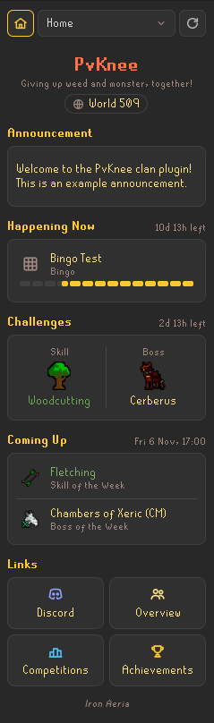
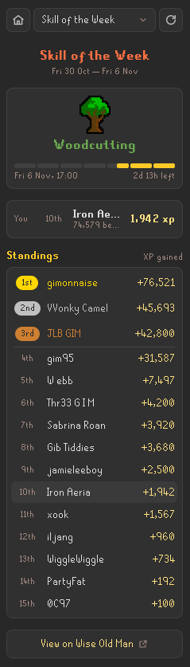
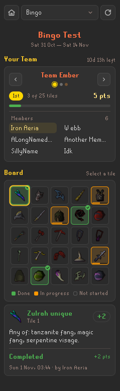
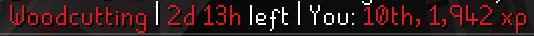
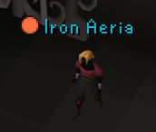
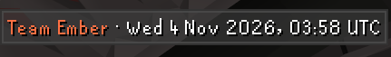

# PvKnee Clan

A sidebar panel for the PvKnee clan: install it, click the icon, and see what the clan is doing.

**Install:** in RuneLite, open the Configuration panel (the wrench icon), click **Plugin Hub**, search for **PvKnee Clan**
and click Install. The PvKnee icon then appears in the sidebar.

Anyone can install it and view the clan's pages, but it is made for PvKnee members: your place in the challenges and
the bingo team icons only mean something if you are in the clan.

<table>
  <tr>
    <td align="center"> Home</td>
    <td align="center"> Skill of the Week</td>
    <td align="center"> Bingo</td>
  </tr>
</table>

## Features

### Overview

View a summary of the clan, home world, current and upcoming events.
Participate in boss/skill of the week, or view current events such as bingo boards directly within RuneLite.

### Skill and Boss of the Week

- **Challenges.** Participate in this week's skill/boss challenge to climb the ranks for this week.
- **Standings.** View clan members' gains for each challenge, updated regularly.
- **Your place.** Your own place and gain, with your row highlighted in the standings.

### Events and links

- **Events.** What's happening now and what's coming up, in your local time or UTC.
- **Links.** One-click buttons to the clan's Discord and Wise Old Man pages.

### Chat

- **Login message** (off by default). This week's challenges in chat when you log in.
- **Chat commands.** Type `!sotw` or `!botw` for the challenge, its time left and your place. Only you see the reply.

  

### Bingo

- **Bingo page.** Each team's board coloured by progress, tile details (what's needed, who got what and when), team
  standings and the winner.
- **Interactive tiles.** Click tiles to view the tile requirements, see completion points and partial progress of
  players through a tile.
- **Team icons.** Toggleable coloured dots beside your clanmates' names in chat, and above their heads if RuneLite's
  Player Indicators plugin is turned on.

  

- **Team overlay.** While you're on a team, a small box with your team and the UTC date and time, useful for screenshot
  proof for manual bingo submissions.

  

## Settings

- **Display:** **Show times in UTC** (off): all times in UTC instead of your local time.
- **Chat:** **Login message** (off): this week's challenges in chat once each time you log in.
- **Wise Old Man:** **Update on logout** (off): updates your Wise Old Man profile when you log out after
  making progress, so your place in the challenges stays up to date.
- **Bingo** (all on): **Team icons in chat**, **Team icons above heads** and
  **Bingo team overlay**.

## Services the plugin contacts

| Service | Address | What for |
| --- | --- | --- |
| The clan's Google Apps Script | `script.google.com` (redirects to `script.googleusercontent.com`) | The panel's pages, theme, competitions and their standings, events, links and bingo, built from the clan's Google Sheets |
| Wise Old Man | `api.wiseoldman.net` | Only with **Update Wise Old Man on logout** on: a profile update for your username |
| GitHub | `raw.githubusercontent.com` | Boss icons from Wise Old Man's public repository |

Skill and item icons come from RuneLite itself; all other icons are built into the plugin.
Images are only ever loaded from `https://raw.githubusercontent.com`, at most 256 KB and 512 pixels a side; the
clan sheet cannot point the plugin at any other site.

## What leaves your computer

- **The request for the clan data**, to Google. It carries no player data: every member gets the same response.
- **Your username**, to Wise Old Man, only if you turn on **Update Wise Old Man on logout**, and only when it sends.
- **Requests for boss icons**, to GitHub. They carry no player data.

Nothing else is sent anywhere. Your clan rank, world and name are read from the game client and stay on your
computer, and the standings come with the clan data, so the plugin never looks anyone up. As with any web request,
each service can see your IP address.

## Stored on your computer

- The last clan data that loaded successfully, in RuneLite's plugin data folder, so the panel can still show
  something, with a "Last updated" time, when the clan's endpoint cannot be reached.
- With **Update Wise Old Man on logout** on, when each name was last sent, in RuneLite's settings, so it is sent at
  most once every 10 minutes even across restarts.

## Licence

BSD 2-Clause; see `LICENSE`.
